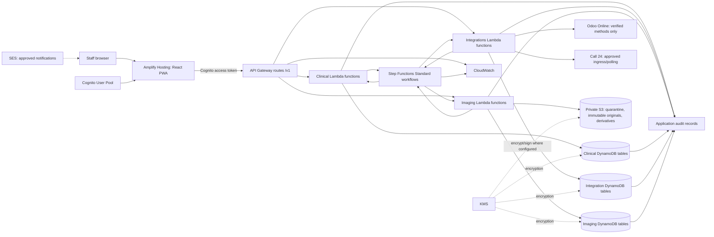

# SUPERSEDED — Historical AWS Pool Proposal

> **Do not use this proposal as the current Moriton P1 architecture or provisioning guide.** It analyzed the earlier Amplify/API Gateway/Lambda/DynamoDB/Step Functions pool shared in chat. The client’s 15 November 2026 documents supersede that interpretation: use the three-service Django/DRF + ECS/Fargate + PostgreSQL + SQS baseline in the client Final Architecture LLD v1.3 and AWS Component List and Costs. See [v1.3 Scope Impact and AWS Readiness](Moriton_P1_v1_3_Scope_Impact_and_AWS_Readiness.md). The content below is retained only as historical analysis and must not drive implementation, estimates, IaC or procurement.

---

# Historical Moriton P1 — Three-Service LLD for the Restricted AWS Pool

**Version:** 1.3 proposal
**Date:** 13 November 2026
**Status:** Architecture impact assessment and proposed replacement for v1.2; **not approved for AWS provisioning or production use**. Requires client confirmation of scope, exact resource manifest, regional limits, cost ceiling, security policies and operational ownership.

> This proposal treats the client's latest AWS component pool as the only AWS service pool available to Moriton. It does not treat the component list as evidence that the listed features, budgets, security configuration, or resource counts have been approved. It also does not assume that the document-generation use cases in the pool (Green narratives, Blue dossiers, Word/PDF assembly) are Moriton clinical requirements.

## 1. Executive architecture decision

### 1.1 Proposed direction

Preserve the three service boundaries approved for Moriton, but change their implementation model:

1. **Clinical Operations Service** — Python Lambda handlers and domain packages; Clinical DynamoDB tables.
2. **External Integrations Service** — Python Lambda handlers; Call 24 intake, Odoo adapter, operation ledger and reconciliation records in Integration DynamoDB tables; Step Functions Standard workflows coordinate long-running operations.
3. **Imaging Service** — Python Lambda handlers for upload authorization, metadata and bounded processing; immutable original DICOM objects in private S3; Imaging DynamoDB tables.

The React/TypeScript dashboard is hosted with Amplify Hosting. Cognito authenticates staff. API Gateway validates access tokens and routes versioned HTTP APIs to service-owned Lambda handlers. S3 stores original and derived imaging objects. Step Functions Standard provides durable workflow state and human approval orchestration. CloudWatch and CloudTrail provide operational and AWS-activity records, while application audit is explicitly maintained by Moriton. KMS protects keys and selected signatures. SES is available for policy-approved notifications.

This remains **three bounded, independently releasable services**, not a single service with three labels. Each service owns its data model, tables, Lambda deployment unit, IAM role, API routes, migrations/versioning strategy, and audit events. Cross-service writes are forbidden; inter-service work uses explicit versioned commands and state-machine tasks that call the owning service's handler/API. No service reads another service's DynamoDB items directly.

### 1.2 Component mapping

| Current v1.2 element | Proposed pool replacement | Consequence |
|---|---|---|
| React assets on CloudFront | Amplify Hosting | Removes separately managed CloudFront from the proposed inventory; frontend build/deploy becomes Amplify-managed. |
| Django/DRF API on ECS/Fargate behind ALB | API Gateway + service-owned Lambda handlers | Django request lifecycle, long-running workers, middleware and container tuning must be replaced or substantially adapted. |
| PostgreSQL RDS with three logical DBs | Three service-owned DynamoDB table groups | No SQL joins, relational constraints, RLS or Django ORM. Data access patterns and aggregate boundaries must be redesigned. |
| SQS queues + DLQs and outbox workers | Step Functions Standard workflows; S3 event notifications only for object intake; durable operation records in DynamoDB | No SQS or generic queue in the permitted pool. Every asynchronous workflow needs explicit state, idempotency, retry and stuck-work recovery. S3 notifications are duplicate/out-of-order capable. |
| ECS worker autoscaling | Lambda invocation + Step Functions | No warm worker pool or Fargate Spot. Runtime, memory, execution duration, concurrency and DICOM batch size become explicit Lambda limits. |
| Secrets Manager | No listed direct replacement | Credentials must be avoided where possible and supplied through approved deployment/runtime mechanisms; any managed secret store outside this list is prohibited unless separately approved. This is a security design gap for vendor credentials. |
| WAF, ALB and private VPC topology | API Gateway controls, Lambda IAM, Cognito, S3 policy and approved network controls | AWS WAF is outside the new pool. Confirm acceptable API abuse protection, private network/device restrictions, and vendor ingress restrictions. |
| API Gateway explicitly prohibited by v1.2 | API Gateway + Lambda is now in the pool | v1.2 allowlist and prohibitions must be replaced, not layered together. |
| RDS/DynamoDB both previously prohibited | DynamoDB now in the pool; RDS absent | Django ORM schema is not portable as-is; this is a substantial data-model and persistence rewrite. |

### 1.3 Important feasibility finding

The new pool can support registry, reception, appointment, clinical workflow, integration-ledger, and DICOM archival foundations, subject to implementation and security decisions below. It introduces three material constraints that need explicit client acceptance:

- **No SQS:** Step Functions can durably orchestrate a known workflow but does not act as a general-purpose, independently consumable queue. Queue semantics, FIFO message grouping, standard retry/dead-letter handling and queue-age scaling from v1.2 must be redesigned.
- **No relational database:** DynamoDB can provide conditional writes and bounded ACID transactions, but the team must define access patterns and denormalized projections before porting normalized Django models. Cross-service atomicity remains unavailable.
- **No listed vendor-secret service or WAF:** approved storage/rotation for Call 24 and Odoo credentials and production edge-abuse controls are not resolved by the pool as written.

If either missing control is a contractual requirement, it is a feasibility blocker under a literal reading of “nothing extra.” Do not silently add a product.

## 2. Scope and assumptions

### 2.1 Moriton P1 scope retained

Main facility, horses only: staff identity and scoped authorization; horse/contact registry; Call 24 intake and reception; appointments and arrival; visit and handoff; screening/isolation foundations; clinician assignment; draft and signed clinical records with protected correction; laboratory workflow; prescription verification, reservation intent, physical issue, administration, return/waste and reconciliation; proposed charges and Odoo financial synchronization; departure coordination; DICOM original archival, metadata and reviewed-report linkage; historical import; audit and operational reporting.

P1 does not include AI inference/training, cross-organization clinical-history sharing, or unapproved clinical, billing, medication-conversion, departure, or device-assurance policies.

### 2.2 Assumptions used by this proposal

- AWS region, account layout, service quotas, data residency, legal retention, and encryption-key ownership remain client decisions.
- All services deploy in one approved AWS account and one primary region unless the client approves a different topology. DynamoDB transactions are region-local; no multi-region consistency is implied.
- Three DynamoDB table groups (Clinical, Integrations, Imaging) are proposed to enforce ownership. Exact table count is an implementation detail to approve in the concrete resource manifest.
- The client approves a client-controlled build/deployment runner and a least-privilege deployment identity. Neither is an AWS application component in the pool.
- Existing React UI and Python domain logic can be inspected and selectively reused; existing Django ORM, PostgreSQL migrations, server middleware and Docker worker processes are not assumed reusable without changes.
- No live Odoo writes, production Call 24 connections, clinical sign-off policy, or real patient migration is enabled until its gate passes.

## 3. Target topology and service ownership



The diagram shows logical flows only. It is not a provisioning authorization or proof that every service integration is available in the selected region/account. Actual routes, IAM policies, encryption configuration and resource counts must be approved in the deployment manifest.

### 3.1 Ownership rules

| Service | Owns | Cannot do |
|---|---|---|
| Clinical Operations | User-to-organization/branch membership projection; horse/contact; reception, scheduling, visits, screening/isolation decisions; clinical notes and signatures; lab; prescriptions/physical issues/administration; charge sources; departure status; clinical audit and idempotency | Read another service's tables; post Odoo transactions directly; treat an image-processing result as a diagnosis; let a token claim alone establish branch access. |
| External Integrations | Call 24 connection/import receipts and source-event dedupe; operation state, remote references/evidence, Odoo adapter and reconciliation; integration audit | Determine clinical approval or patient identity; claim local keys guarantee remote exactly-once behavior; replay uncertain Odoo writes. |
| Imaging | Upload intents; study/series/instance metadata; original object version/checksum; processing state; technical reports and annotation revisions; imaging audit | Change a signed clinical interpretation; alter original DICOM bytes; choose horse/visit identity without authorized Clinical linkage; claim a browser preview is diagnostic. |

Each cross-service command includes `event_id`, `schema_version`, `correlation_id`, `causation_id`, `organization_id`, `branch_id`, `aggregate_type`, `aggregate_id`, `aggregate_sequence`, `predecessor_operation_id`, `actor_id`, `authorization_version`, `occurred_at`, and a payload hash. The receiver validates producer identity, schema, scope, current authorization where required, sequence/predecessor and duplicate receipt before applying a transition.

### 3.2 Deployment units

- Separate build artifacts/function groups and IAM execution roles for `clinical`, `integrations`, and `imaging`.
- Separate API route groups (`/v1/clinical/*`, `/v1/integrations/*`, `/v1/imaging/*`) and independently versioned OpenAPI contracts.
- One Lambda handler is not allowed to use a broad shared role to access all three data groups. Step Functions execution roles can invoke only explicitly listed owner handlers and state machines.
- Keep domain logic in framework-neutral Python packages. API Gateway/Lambda adapters perform transport mapping; domain operations own validation and authorization decisions.
- Use a Lambda-compatible Python packaging approach. Django may remain useful for local prototyping or shared validation code, but a Django deployment/runtime is no longer the production baseline.

## 4. DynamoDB data model and transactional rules

### 4.1 Modeling rules

The DynamoDB design is access-pattern-first. Each service owns table(s) and indexes, with all records scoped by tenant. Every item has `pk`, `sk`, `entity_type`, `schema_version`, `organization_id`, `branch_id` when applicable, `created_at`, `updated_at`, `version`, and provenance fields. Use opaque UUIDs and explicit GSI projections. Avoid broad scans in interactive requests. Global secondary indexes are query aids, not authorization boundaries; every returned item is rechecked against organization/branch membership.

DynamoDB transactions are bounded to a single AWS account and Region and limited to 100 unique items / 4 MB. They can atomically update multiple tables in that account and Region, but cannot create an atomic transaction across a remote Odoo write, S3 upload, Cognito, or Step Functions. No cross-service transaction is claimed.

### 4.2 Proposed logical tables and key patterns

The exact number of physical tables must be selected after access-pattern review. The following logical groupings are proposed; they do not require one table per entity.

| Owner | Logical records | Suggested key pattern and important attributes |
|---|---|---|
| Clinical | Horse, owner/contact, aliases, organization and branch membership | `PK=ORG#{org}#BRANCH#{branch}#HORSE#{horse}`; `SK=PROFILE`, `CONTACT#{id}`, `ALIAS#{type}#{normalized}`. Search indexes contain only approved searchable fields. |
| Clinical | Reception tasks, Call 24 projections, visits, appointments and resource bookings | Aggregate partition by org/branch and entity ID; time/status GSIs for queues and day views; store external request ID as a conditional unique-claim item. |
| Clinical | Forms, screening, isolation, assignment, notes, diagnoses, procedures, labs | One item per versioned aggregate event/current projection; immutable signed note versions use unique `VERSION#{n}` keys and separate signature/approval records. |
| Clinical | Prescription, physical issue, administration, returns/waste, charge source, departure dimensions | Stable `physical_issue_id`; event records append-only, mutable summary projection with `version`; conditional stock/sequence changes only within Clinical's own inventory-intent data. Odoo remains the stock/accounting authority. |
| Clinical | Idempotency, inbox, outbox/workflow intents, audit | Conditional `Put` on `IDEMPOTENCY#{scope}#{key}`; audit/event rows append-only by IAM and condition; each event carries actor, policy and correlation references. |
| Integrations | Call 24 connection, import batch, source row receipt, normalized event, cursors | Stable provider connection + source event identity; payload hash and restricted source snapshot reference; CSV rows preserve file hash, row number, mapping version and import batch. |
| Integrations | Operation ledger, lease/fence, operation history, remote mapping, reconciliation exception | `PK=OP#{operation_id}`, separate `HISTORY#{sequence}`; conditional version and owner/token/lease-until checks; business key is scoped and unique via conditional create. |
| Imaging | Study, series, instance, upload intent, processing job, report-link projection, annotation revision | Preserve Study/Series/SOP Instance UIDs and transfer syntax; instance metadata references exact S3 key + version ID + SHA-256; conditional UID claim scoped to tenant/source policy. |

### 4.3 No SQL features are assumed

- PostgreSQL foreign keys become conditional existence/scope checks and duplicate-claim items.
- SQL joins become bounded query patterns and denormalized, rebuildable projections.
- RLS becomes explicit organization/branch authorization in every handler, with test cases for each access path. GSI filters are not sufficient authorization.
- Exclusion constraints for appointment-room conflicts become conditional transactions against deterministic resource/time-slot claim items. Define slot granularity and time zone semantics before enabling bookings.
- Cross-record updates use conditional writes/`TransactWriteItems` only when they fit transaction bounds. Longer workflows use a saga/state machine and compensating states.
- Reporting uses bounded query/index views or approved exports assembled by Lambda; do not add a warehouse/search service outside the pool.

### 4.4 Access patterns that must be specified before implementation

At minimum: horse lookup by exact identifiers and reviewed search terms; owner/contact lookup; reception work queue by branch/status/age; appointment calendar by branch/resource/day; visit overview by horse and status; active screening/isolation list; prescription/physical issue history; unresolved integration operations by state/age; Call 24 source event lookup; imaging study search by horse/visit/date; and audit retrieval by aggregate/actor/time. Query pagination, maximum page size, index projection, read consistency and data-retention behavior are specified in OpenAPI and table design records.

## 5. API contracts and request processing

### 5.1 API standards

- `/v1` major version path; JSON request/response schemas published in OpenAPI.
- RFC 3339 UTC timestamps plus explicit facility time-zone identifier where local scheduling semantics matter.
- UUID identifiers; stable `Idempotency-Key` required for creates and state-changing actions; request payload hash stored with the key. Reusing a key with a different payload returns conflict.
- Common error shape: `code`, `message`, `correlation_id`, optional `field_errors`; never include protected clinical text in infrastructure logs.
- Cursor pagination and bounded page sizes; no unbounded listing endpoints.
- API Gateway authorizes JWT and route scopes, but service handlers still check current tenant membership, branch, object relationship, action permission and command version.
- Successful mutations return the committed resource version and workflow/operation status; asynchronous submission returns `202` plus an operation identifier, never a false claim of completion.

### 5.2 Example command envelope

```json
{
  "event_id": "uuid",
  "schema_version": "1.0",
  "correlation_id": "uuid",
  "causation_id": "uuid",
  "organization_id": "uuid",
  "branch_id": "uuid",
  "aggregate_type": "prescription",
  "aggregate_id": "uuid",
  "aggregate_sequence": 4,
  "predecessor_operation_id": "uuid",
  "actor_id": "uuid",
  "authorization_version": 12,
  "idempotency_key": "stable-client-operation-id",
  "payload_hash": "sha256:...",
  "occurred_at": "2026-11-13T10:00:00Z",
  "payload": {}
}
```

Clinical assigns monotonic aggregate sequence and predecessor before command/workflow submission. A consumer conditionally accepts only the next expected sequence and predecessor. Out-of-order or stale commands are held as `WAITING_PREDECESSOR` or `STALE`, never applied speculatively.

### 5.3 Example API surface

| Route | Owner | Behavior |
|---|---|---|
| `POST /v1/clinical/horses` / `GET /v1/clinical/horses` | Clinical | Create/search scoped horse; duplicate candidates require review. |
| `POST /v1/clinical/reception/tasks` | Clinical | Idempotent task creation from verified Call 24 projection or manual intake. |
| `POST /v1/clinical/appointments/{id}/request`, `/confirm`, `/arrive` | Clinical | Versioned transition; booking, arrival, visit registration and clearance remain distinct. |
| `POST /v1/integrations/call24/imports` | Integrations | Authorized CSV import submission, validation report and durable batch identity. |
| `POST /v1/integrations/call24/{connection}/events` | Integrations | Machine-authenticated provider ingress; durable receipt then workflow start/accepted response. |
| `POST /v1/clinical/prescriptions/{id}/verify` | Clinical | Validate and create reservation command with sequence; return pending state. |
| `POST /v1/clinical/physical-issues` | Clinical | Record immutable actual issue fact and issue-posting operation; unknown Odoo result remains unknown. |
| `POST /v1/integrations/operations/{id}/reconcile` | Integrations | Authorized controlled query/reconciliation; no blind replay. |
| `POST /v1/imaging/upload-intents` | Imaging | Verify Clinical authorization/linkage evidence and issue narrow, short-lived quarantine upload grant. |
| `POST /v1/imaging/upload-intents/{id}/complete` | Imaging | Verify object version/checksum and start processing workflow. |
| `GET /v1/imaging/studies/{id}` | Imaging | Return scoped metadata and a newly authorized short-lived view/download grant when permitted. |

## 6. Authentication, authorization, and device controls

### 6.1 Staff authentication

Cognito User Pool is the identity provider. Amplify frontend uses Authorization Code with PKCE and sends Cognito access tokens to API Gateway. Prefer access tokens with custom API scopes, not broad ID-token authorization. API Gateway validates signature, issuer, audience/client and expiry; Lambda reads verified claims. Tenant and branch access is decided by Clinical using current membership and action policies, not only token group claims.

### 6.2 Revocation and queued-command revalidation

- Every privileged command records actor, tenant/branch, permission/policy version, submitted time, resource version and workflow/operation ID.
- Before each privileged side effect, the owning service re-reads current membership, role, approval state, device grant and policy version. If revoked, state becomes `CANCELLED_AUTH_REVOKED` before a side effect when possible.
- A command already physically executed cannot be erased after revocation. Record the physical fact, stop any further automated action, preserve it for clinical review and reconcile remote effects.
- Long-lived state-machine waits require current authorization at approval and at execution; submission-time permission does not permanently authorize later steps.
- Cognito JWTs have bounded lifetime; immediate application revocation is enforced by current membership lookup/authorization version in DynamoDB. Define acceptable residual token exposure and session revocation procedure.

### 6.3 Device and field access

Cognito alone does not attest that access comes from managed hospital hardware. The client must select WebAuthn possession proof vs managed-device certificate/attestation. Since MDM, AWS Private CA and other device products are outside the stated pool, guaranteed managed-device-only enforcement is **not demonstrated** under this inventory. Until resolved, enforce separate short-lived field-access grants, least privilege, session revalidation and explicit audit; do not claim physical-device assurance.

### 6.4 Machine identities and credentials

Use distinct Lambda execution roles and API Gateway resource policies for internal callers. Odoo/Call 24 credentials need a client-approved protected storage and rotation mechanism. No plaintext environment variables, source files, logs or frontend secrets. If a protected managed secret store is not permitted, live vendor integrations remain blocked. Short-lived AWS execution credentials do not solve third-party vendor credential storage by themselves.

## 7. Durable operations and workflow recovery without SQS

### 7.1 Required operation record

Each externally consequential operation is recorded before remote execution:

```text
operation_id, organization_id, branch_id, provider, operation_type,
aggregate_id, business_key, payload_hash, remote_reference,
status, attempts, max_attempts, workflow_execution_arn,
lease_owner, lease_token, lease_until, next_attempt_at,
predecessor_operation_id, last_error_code, reconciled_at,
actor_id, authorization_version, version, created_at, updated_at
```

Operation statuses: `PENDING`, `IN_PROGRESS`, `CONFIRMED`, `REJECTED`, `UNKNOWN`, `RECONCILING`, `RETRY_WAIT`, `MANUAL_REVIEW`, `CANCELLED`, `CANCELLED_AUTH_REVOKED`. Transitions are conditional on expected state/version and append a history item.

### 7.2 Step Functions usage

- Use **Standard** workflows for durable integrations, dispensing/invoice coordination, imaging import and human approvals.
- Start workflows with a stable execution name derived from the immutable operation ID. DynamoDB conditional writes remain the business idempotency authority; Step Functions execution names alone do not protect a completed operation or Odoo.
- Each Lambda task is idempotent by operation ID and state/version. `Retry` is configured only for classified transient errors whose side effect is known safe; otherwise branch to reconciliation.
- State machine input contains references and minimized metadata, not full clinical payloads, image bytes, credentials or DICOM objects. Store sensitive details in owner-controlled DynamoDB/S3 and pass opaque IDs.
- Use explicit timeout, catch, compensation, `UNKNOWN` and `MANUAL_REVIEW` branches. Long-running human review uses callback correlation stored securely, then revalidates the reviewer and workflow state before resuming.
- Step Functions Standard execution history is operational evidence, not the application ledger or clinical audit record.

### 7.3 Start/recovery gap

Without a queue or scheduler, persisting a command and starting a workflow are separate actions. API handlers must use a recoverable `WORKFLOW_START_PENDING` record: same-key client retry can safely attempt start; an operator/API reconciliation path can query execution state and recover stuck commands. If the client requires automatic periodic recovery independent of client retries/operator action, the current component pool has no listed scheduler/queue for that function. Treat this as an explicit gap; do not add EventBridge Scheduler, SQS or another service without approval.

### 7.4 Odoo uncertainty rules

For a timeout after a write may have reached Odoo: mark `UNKNOWN`; do not resend. Query the exact supported remote business object(s) using a tested correlation reference; verify company, product, quantity, lot, state, amounts and related records. If exactly established, mark `CONFIRMED`; if ambiguity remains, `MANUAL_REVIEW`; retry only when the remote absence is proven and operation policy says safe. PostgreSQL or DynamoDB local idempotency does not prevent Odoo duplicate processing. Standard workflow execution semantics do not establish exactly-once remote business effects.

The exact Odoo Online subscription, methods, permissions, stock/picking behavior, invoice/payment methods, correlation fields and recovery queries remain vendor proof gates.

## 8. Clinical data and workflow contracts

### 8.1 Stable domain invariants

- Tenant scope on every protected record; UUIDs; actor, timestamps, version and audit correlation.
- A signed clinical record is immutable. Corrections are new addenda/revisions with independent approver and link to the signed original.
- A prescription is a clinical instruction, not a stock movement. Reservation, physical issue, administration, return and waste are distinct records.
- `physical_issue_id` is stable and immutable. Corrections reference original issue and represent only the actual difference/return/reversal. Administration never creates a second stock deduction.
- Clinical creates sequence and predecessor before publishing consequential commands. Cancellation cannot leapfrog an unresolved prior issue; reconcile ordering first.
- Billing event policy is a client gate. Dispensing is not automatically the billing trigger. A posted Odoo invoice correction uses an approved credit/adjustment and original invoice reference.
- Physical departure, clinical completion, financial clearance, lab follow-up, ERP synchronization and owner-document delivery remain independent status dimensions. No generic `CLOSED` flag.

### 8.2 State models retained

| Workflow | Proposed states |
|---|---|
| Reception task | `NEW → ASSIGNED → IN_PROGRESS → RESOLVED/CANCELLED` |
| Appointment | `REQUESTED → CONFIRMED → ARRIVED`; separately `NO_SHOW/CANCELLED`; arrival does not imply visit or clinical clearance. |
| Screening | `NOT_STARTED → IN_PROGRESS → AWAITING_VET_REVIEW → ROUTINE_CLEARED/ISOLATION_REQUIRED` |
| Isolation | `REQUIRED → PLACED → MONITORING → RELEASE_AUTHORIZED → RELEASED`; stall availability requires a cleaning event. |
| Visit dimensions | Clinical `IN_PROGRESS/READY/COMPLETED`; physical `PRESENT/DEPARTED/TRANSFERRED`; finance `UNVERIFIED/DUE/CLEARED/EXCEPTION_APPROVED`; lab and ERP independent. |
| Clinical note | `DRAFT → SIGNED`; signed corrections are addenda/revisions only. |
| Laboratory | `REQUESTED → COLLECTED → DISPATCHED/PROCESSING → RESULT_RECEIVED → REVIEWED/FOLLOW_UP` |
| Prescription | `DRAFT → VERIFIED → RESERVATION_PENDING → RESERVED/SHORTAGE/UNKNOWN`; physical issue and administration are separate histories. |
| Odoo operation | `PENDING → IN_PROGRESS → CONFIRMED/REJECTED/UNKNOWN → RECONCILING → CONFIRMED/MANUAL_REVIEW` |
| Imaging | `INTENT_CREATED → UPLOADED → QUARANTINED → VALIDATING → ARCHIVED/REJECTED → DERIVATIVES_READY`; clinical linkage review remains separate. |

Clinical policies for screening, emergency clearance, signing, substitutions, medication conversions, discharge blockers, financial exception approval and notification recipients remain disabled/configurable until signed approval.

## 9. Call 24 integration LLD

1. Accept only an approved authenticated webhook/polling contract or an operator-submitted CSV. The supplied CSV remains a fallback adapter, not proof of the live source API.
2. Persist import batch, file SHA-256, mapping version, source row number, source payload hash and stable provider IDs using conditional writes. Separate parent requests from child calls.
3. Normalize to versioned `call24.request.received/updated.v1`; validate counts and links; reject or flag ambiguous identifiers. Do not deduplicate only by phone, timestamp or text.
4. Start the appropriate durable Step Functions workflow with a stable operation key; retry is idempotent and does not create a second reception task.
5. Clinical receives normalized, scoped data and creates/revises one reception task per verified external request identity. Horse matching remains staff-reviewed; ingestion does not create visits or clinical clearance.
6. Store caller/contact details only under approved retention/access controls. CSV test data and production data use separate environments and credentials.

No scheduled poller is assumed because a scheduler is absent from the allowed pool. If polling is required and cannot be triggered externally by the provider/client, that capability needs confirmation or a pool exception.

## 10. DICOM storage, processing and access

### 10.1 Upload and archive

1. Authorized staff request an upload intent for an existing horse/visit; Imaging checks a current Clinical authorization/linkage assertion and creates a one-use intent with tenant scope, allowed format, max bytes/parts, expected checksum policy, quarantine key, actor, expiry and status.
2. Return a short-lived S3 presigned upload grant scoped to one quarantine object/key and operation. Initial target: no more than 5 minutes unless large-file usability tests require an approved exception. A copied URL remains a bearer capability until it expires or its signing credentials/policy are invalidated; do not claim immediate per-link revocation. Do not place it in logs/analytics.
3. Use multipart upload for large objects; verify finalized part list, object version, actual content length, declared media type and checksum server-side. Uploaded bytes remain quarantined and not viewable.
4. S3 object-created notification starts the Imaging workflow. Notifications are treated as at-least-once and potentially out of order; conditional job creation and `object_key + version_id + checksum` deduplicate processing.
5. Validate original DICOM bytes in bounded Lambda steps; preserve original exact object version, SHA-256, transfer syntax UID and Study/Series/SOP Instance UIDs. Never overwrite source bytes. Duplicate SOP UID policy is a clinical/data-governance decision: quarantine and review rather than silently replace.
6. Create derived previews separately. Preview is non-diagnostic unless a named viewer, supported modalities, calibrated display requirements and acceptance test are approved. Reports and annotation revisions remain versioned and provenance-linked.
7. Clinical linkage corrections are reviewed, audited and versioned; uncertain patient matching never auto-links.

### 10.2 Size/runtime feasibility

The current pool names Lambda but gives no image-processing memory/runtime sizing. DICOM instances can exceed simple request and Lambda-processing assumptions. Upload directly to S3; never route object bytes through API Gateway. Test representative modalities, compressed transfer syntaxes, multiframe files, large studies, malformed inputs and cold starts. If processing cannot fit Lambda limits and the listed containerized renderer does not support the required DICOM pipeline, production viewer/processing is blocked unless the client approves an allowed implementation or pool exception.

### 10.3 Object lock and retention

S3 versioning is required for originals. Object Lock can provide WORM retention only with explicit retention/legal-hold policy, versioning, role separation and irreversible-mode review. Do not enable Compliance mode or indefinite retention until legal/client policy signs off. KMS encryption and access-controlled per-intent grants are required. S3 access logs/CloudTrail data events and their cost/retention must be included in the approved manifest.

### 10.4 Viewer access and revocation

Viewer access is checked by Imaging for every grant; grants are object/version-specific and short-lived. Revocation blocks future grants immediately, while already issued presigned URLs remain usable until expiry or underlying credentials/policy invalidation; active downloads may continue. The client must accept this delay or require a proxy/streaming authorization design (not represented by the listed pool). No diagnostic-viewer capability is accepted until a representative image set and clinical reviewer sign off.

## 11. Security, audit, and observability

- Amplify must serve only static application assets; no patient records or long-lived credentials in browser storage. Use approved CSP, secure headers, build integrity and branch/environment separation.
- Cognito scopes gate route classes; current role/membership/device/branch authorization is checked in each owning service. Never trust frontend-hidden buttons.
- API Gateway request validation, throttling and payload-size caps reduce abuse; they do not replace WAF. Confirm whether the listed pool intentionally excludes WAF and what API protections client accepts.
- Lambda execution roles are per service and least privilege. S3 roles are prefix/version constrained; function code cannot read other service tables. State-machine roles can invoke only listed owner operations.
- KMS encryption for DynamoDB/S3 and optionally asymmetric signing. Key rotation, separation, recovery, key deletion protection and ownership are specified before production.
- CloudTrail records AWS API activity; CloudWatch holds operational logs/metrics/alarms. Neither is the Moriton clinical audit trail.
- Every business event appends an application audit item in the owner table with actor, action, before/after version references, tenant scope, timestamp, policy version, correlation and payload hash. Sensitive bodies and credentials are not copied into logs.
- Audit immutability is enforced through append-only application behavior, conditional create, IAM denial of updates/deletes for runtime roles, and periodic hash/signing evidence where approved. DynamoDB records alone do not provide WORM guarantees. S3 Object Lock for audit manifests is a separate irreversible retention decision.
- Alert on authorization failures, Lambda throttles/errors/concurrency, workflow age/failures, `UNKNOWN` Odoo operations, reconciliation backlog, Call24 import failures, DICOM quarantine/scan errors, object-access denies, storage growth, Cognito errors and SES bounces. Thresholds and on-call coverage must be set from workload and operations policy.

### 11.1 Upload security control gap

“Upload security checks” is described as an allowance, not a named component or implementation contract. File extension/MIME checks, size limits, parser isolation, checksum, malware scanning and quarantine are different controls. Lambda validation plus quarantine does not prove malware scanning. Client must identify what scanner/approach is allowed and how signatures are updated. Until verified, uploaded content remains untrusted and must not be opened by clinical clients.

## 12. Integrations and finance

### 12.1 Odoo Online

Keep the `OdooPort` domain interface but implement only after the subscription/version, supported API methods, permissions, business references, duplicate behavior, timeout behavior and representative test database are evidenced. Candidate entities (`res.partner`, product/stock objects, picking/moves, invoices and payments) are not approved method mappings. No custom Odoo server module is assumed.

Operation inputs include stable business identity, payload hash, expected version, actor/approval evidence and predecessor. Adapter records request intent before network call; maps response to remote reference; after ambiguous timeout, searches and reconciles before any retry. Finance/Director permissions must be enforced inside Odoo where supported; Moriton can detect unexplained direct changes but cannot prevent them if Odoo grants bypass rights.

### 12.2 Billing and deposits

Keep separate events for physical medication issue, administration, service performance, charge proposal/approval, invoice post, deposit/payment confirmation, credit/refund and financial clearance. A `charge_source_id` links source event, version, amount, currency, price and remote invoice line. The client must select the charge trigger. Posted documents are corrected using approved Odoo credit/adjustment workflows. Deposit confirmation is not full financial clearance.

### 12.3 Notifications

SES is used only after approval of notification types, recipients, sender/domain validation, opt-out and clinical privacy text. Email/SMS-like notifications are not a clinical record or authorization channel. Do not send protected diagnosis or DICOM links with long-lived access tokens. Failed sends remain auditable and do not imply clinical workflow failure unless policy explicitly says so.

## 13. AWS pool classification and cost interpretation

| Pool component | Moriton P1 disposition |
|---|---|
| Amplify Hosting | Required for dashboard static hosting in this proposed topology. |
| Cognito | Required for staff authentication, subject to membership/device authorization design. |
| API Gateway + Lambda | Required production API/runtime replacement for Django/ECS. |
| S3 | Required for DICOM originals, quarantined uploads, derivatives and approved documents. |
| DynamoDB | Required persistence replacement; data model/access patterns must be redesigned. |
| Step Functions Standard | Required for long-running integrations, imaging and human approval orchestration. |
| CloudWatch + CloudTrail | Required operational/AWS auditing; separate from app-level audit. |
| KMS | Required for encryption keys and optional signing. |
| SES | Conditional; only policy-approved notifications. |
| Upload security checks | Required but implementation/provider is not specified; gap until accepted. |
| Textract | Not needed for current horse/visit/DICOM workflows. Enable only if OCR of approved clinical forms is in P1 scope, with human review and source provenance. |
| Bedrock | Not needed and not enabled for current P1. AI classification, image interpretation or generated clinical narrative is out of scope; client language appears to describe another workflow. |
| Containerized document renderer | Not needed for DICOM itself. Conditional only if the client requires Word-to-PDF clinical documents; Lambda packaging/runtime feasibility must be proven. Fargate is not in the pool. |

The client's estimates sum to approximately **$18–$78/month** if each stated low/high estimate is added once, before traffic-dependent usage, data transfer, storage growth, taxes, support and any unlisted operational cost. This is only arithmetic over the supplied estimates, not a validated forecast. Bedrock/Textract should not be budgeted as active Moriton consumption until their use is confirmed. Build a workload-based estimate using expected requests, Lambda memory/duration, Step Functions transitions, DDB reads/writes/storage, DICOM GB/month, retention, CloudTrail data events, KMS requests, email volume and upload scanning. Obtain AWS pricing confirmation for the selected region.

## 14. CI/CD, environment and recovery

- Keep local Docker Compose for current development and regression; it remains a development harness, not the target runtime.
- Add local DynamoDB/S3/Lambda-compatible integration tests only if dependencies and behavior can be validated; local emulation is not AWS acceptance evidence.
- Build three service packages independently. Publish versioned Lambda artifacts and API contracts; use backward-compatible schema rollout. No production secrets in build artifacts.
- Deployment runner location, role trust, approval gates, artifact retention and rollback are client-controlled decisions. No runner or infrastructure component is inferred from the pool.
- Terraform/IaC inventory must contain only explicitly approved resource types. Policy test rejects RDS, ECS/Fargate, ALB, SQS, WAF, Secrets Manager, EventBridge/Scheduler, Redis, EKS, PACS, and any other unapproved resource. A required control outside the pool is escalated, never smuggled into infrastructure.
- DynamoDB point-in-time recovery, table backups/export, S3 versioning/Object Lock and restore workflow must be enabled/approved. CloudTrail and workflow history are not backups. Cross-account recovery is unavailable unless the client permits a second account and associated resources.
- RPO/RTO targets are client-approved and demonstrated in restore exercises. On recovery, pause consequential Odoo writes until operation ledger, Odoo state, Call24 source cursors and S3 object versions are reconciled.
- Step Functions history is available for its configured retention window and is not the permanent business ledger. Copy required workflow summaries into the owned operation/audit records.

## 15. Migration and implementation sequence

1. **Architecture gate:** confirm pool applies to Moriton; clarify document-generation/AI language; sign service boundaries, no-SQS recovery limitation, secret storage, API abuse controls, device assurance, backup/retention and cost ceiling.
2. **Contract gate:** freeze OpenAPI, event schemas, DynamoDB access patterns, key/index plan, idempotency and sequence rules; map current Django entities to DynamoDB aggregates.
3. **Foundation:** build Cognito/API Gateway/Amplify local contract tests and separate Lambda packages/IAM policies; create DynamoDB schema and conditional write primitives. Keep AWS resources unprovisioned until signed manifest approval.
4. **Clinical vertical slice:** horse → reception → appointment → arrival → visit with no automatic screening clearance. Use scoped tenant access and audit records.
5. **Call24:** CSV and mock provider through durable import/event/operation records and Step Functions; verify duplicate rows, parent/child counts, unknown identity and recovery.
6. **Pharmacy and Odoo:** implement immutable physical issues and operation ledger using mocks; vendor sandbox proof for all actual writes before enabling them.
7. **Imaging:** upload intent, quarantine, metadata, checksum, original preservation, DICOM samples, duplicate UID and late-instance handling; then viewer proof with clinical reviewer.
8. **Clinical extensions:** screening/isolation, notes/signature/addenda, laboratory, surgery/inpatient/field states, discharge and billing after policy approvals.
9. **Cutover/migration:** export historical source records, stage with hashes and identity mapping, review candidates, import read-only history first. Never replay historical stock movements, payments or receivables. Cut over only after reconciliation and rollback rehearsal.

## 16. Acceptance evidence

| Area | Minimum evidence before production enablement |
|---|---|
| AWS allowlist | Signed resource manifest with region, counts, ceilings, IAM roles, data-retention policy and cost ceiling; automated IaC policy test passes. |
| DynamoDB | Access-pattern review; conditional uniqueness/concurrency tests; tenant-isolation negative tests; transaction-boundary and hot-key/load tests; PITR/restore evidence. |
| API/auth | Cognito issuer/audience/scope validation; current-membership revocation test; branch isolation; CSRF/token handling where browser cookies are used; rate/payload constraints; authorization regression suite. |
| Workflow recovery | duplicate StartExecution/client retry; Lambda timeout before/after side effect; stranded `WORKFLOW_START_PENDING`; stale worker/result; revoked actor; predecessor ordering; manual-reconcile behavior. |
| Odoo | Subscription/version, exact API methods/permissions, duplicate/timeout/lost-response proof, reconciliation query and signed approval of live operation classes. |
| Call24 | Live API/auth/source contract or approved CSV operating procedure; timezone/tenant fields; stable ID and parent-child semantics; duplicate/replay and recovery evidence. |
| DICOM | Representative modality/transfer-syntax samples; original byte/hash/version preservation; duplicate/late instance handling; malware/upload-control proof; user/branch grant and revocation test; named viewer reviewer sign-off. |
| Clinical | Approved screening/signature/correction/discharge/finance policies; protected correction approval and immutable history; role matrix and revalidation tests. |
| Security/operations | Vendor-secret solution; API abuse control decision; KMS key/retention ownership; audit review; CloudWatch alarms; incident procedures; tested restore and support staffing. |
| Frontend | Amplify build, Cognito login, API demo against deployed non-production backend, no Firebase unintended writes, accessibility/Mongolian review and synthetic data proof. |

## 17. Decision register / client confirmation required

| ID | Decision / evidence | Why needed | Default if unresolved |
|---|---|---|---|
| D1 | Does the AWS pool supersede the previous Moriton ECS/RDS/SQS allowlist and apply to this clinical project? | The new pool description includes document-generation and AI use cases outside current Moriton LLD. | Keep this as a proposal only; no deployment changes. |
| D2 | Is the three-service boundary still mandatory under Lambda, and are separate Lambda deployables/tables accepted as “services”? | Runtime differs while business boundaries can remain. | Preserve boundaries, do not claim architecture approval. |
| D3 | How are Odoo/Call24 secrets stored and rotated without Secrets Manager or another approved secret component? | No listed component provides this contract. | Disable real vendor integrations. |
| D4 | Is there an approved API abuse/WAF control? | WAF is absent from pool. | Do not expose production APIs publicly. |
| D5 | Is no SQS/scheduler an intentional constraint? What operational recovery latency is accepted for stuck workflows/polling? | No independent queue or periodic trigger is listed. | Use persisted workflow-start state and manual/API retry; do not promise unattended recovery. |
| D6 | What is device assurance: WebAuthn or managed endpoint attestation? | Cognito alone does not prove a physical managed device. | Do not claim managed-device-only access. |
| D7 | What upload security scanning mechanism is allowed? | “Upload security checks” does not identify a scanner or verification contract. | Quarantine; no user download/view. |
| D8 | What DICOM modalities, viewer, file-size envelope, retention and duplicate UID policy are required? | Lambda and browser viewer fit must be demonstrated. | Archive original only in gated test; no diagnostic viewer claim. |
| D9 | Which of Textract, Bedrock, and document rendering are actual Moriton P1 requirements? | Current LLD excludes AI; described outputs look like another document workflow. | Do not invoke or charge them. |
| D10 | Approve Cognito organization/branch claims vs live membership lookup, token lifetime and revocation delay. | Authorization and incident response depend on it. | Lookup current membership for privileged actions. |
| D11 | Approve retention/Object Lock mode, DynamoDB backup/PITR, data residency and RPO/RTO. | Object Lock and retention can be irreversible and cost-sensitive. | Versioning and test-only synthetic data; no compliance retention claim. |
| D12 | Approve notification scope and SES content restrictions. | Clinical privacy and workflow policy. | No outbound notifications. |
| D13 | Confirm per-month and per-request cost ceilings with realistic DICOM and Step Functions assumptions. | Supplied low/high figures are indicative only. | No cost commitment. |

## 18. Pros and cons compared with the v1.2 AWS design

| Topic | New restricted pool | Previous v1.2 pool (ECS/Fargate + RDS + SQS + S3 etc.) |
|---|---|---|
| Operating model | Managed/serverless building blocks, less container and host management | Containerized Django services/workers, explicit VPC/ECS/RDS operations |
| Cost at low volume | Potentially low idle compute cost; supplied estimate is attractive if usage stays small | Minimum always-on API/task/database/NAT footprint likely gives a higher baseline; exact price needs workload/region estimates |
| Scaling | Lambda and Standard workflows scale per invocation/execution within concurrency/quotas | ECS tasks and SQS consumers scale using measured queue depth/age; capacity is more explicit and tunable |
| Domain/data fit | DynamoDB requires denormalized access-pattern design and careful indexes | PostgreSQL maps more directly to existing Django models, foreign keys, constraints, complex workflows and reporting |
| Existing code reuse | Pure Python domain logic/contracts and React UI can be reused; Django ORM/views/migrations/workers require replacement | Django/DRF and current PostgreSQL-oriented backend align closely with the existing implementation |
| Cross-service work | Step Functions provides visible, durable orchestration; no generic queue means workflows are more coupled to state-machine definitions and stuck-start recovery must be designed | SQS + outbox/inbox gives explicit asynchronous service queues, DLQs and consumer scaling; still requires idempotency and reconciliation |
| Odoo safety | Operation ledger can be DynamoDB and state-machine orchestration; no solution removes Odoo remote ambiguity | RDS ledger + SQS workers supports leases, sequencing and operations UI; no solution removes Odoo remote ambiguity |
| DICOM | S3 direct upload fits originals; Lambda runtime/concurrency and lack of DICOM-specific service need proof | S3 plus separately sized container imaging workers better accommodates libraries and long/heavy jobs, at higher operational cost |
| Availability/failure isolation | Less host upkeep, but shared account/API quotas and DynamoDB access patterns need management; no SQL service boundary failure domains | ECS/RDS/SQS design allows worker/service separation, but v1.2 explicitly shares one RDS failure/CPU/I/O domain unless expanded |
| Authorization | Cognito/API Gateway provides standard token gate; application still owns branch policy and revocation | Cognito + Django session/DRF checks can express nuanced server-side authorization; both need device assurance and current-policy checks |
| Security operations | Smaller service menu, but missing WAF and Secrets Manager controls are significant if the pool is literal | WAF and Secrets Manager are in prior inventory, supporting edge controls and secret lifecycle, subject to approval/configuration |
| Reporting/search | Requires known key/index patterns and denormalized views; ad hoc joins are expensive/limited | SQL supports joins, aggregation, constraints and operational reports more naturally |
| Lock-in | Higher use of DynamoDB key design, Step Functions ASL, Lambda packaging and AWS integrations | AWS-specific deployment too, but containerized Python/PostgreSQL/SQS patterns are more portable across providers |
| Cost certainty | Low estimates can be exceeded by DDB request patterns, Step Functions state transitions, DICOM bytes, Bedrock/Textract, logging and transfer | Larger fixed baseline is easier to see but RDS class, NAT, Fargate, backups and traffic still need estimation |
| Existing milestone continuity | Major R0-R3 persistence/API/runtime rework; business behavior and test cases remain useful | More direct continuation of current repository and task tracker |

### Recommendation

The pool is a reasonable choice if the client prioritizes a managed, low-idle-cost, AWS-native serverless deployment and accepts a DynamoDB-first redesign, Step Functions-centered orchestration, limited unattended recovery without a scheduler/queue, and the documented security gaps being resolved. The previous ECS/RDS/SQS plan better matches the current Django backend, transactional relational workflows, reporting, explicit worker operation and heavy DICOM processing. It has a higher operational/cost floor and currently shares an RDS failure domain in v1.2.

Do not make the pool decision from the monthly estimates alone. First resolve D1–D9 (especially scope applicability, vendor secrets, API abuse control, no-queue recovery, upload scanning and DICOM processing). If those are answered, update the tracker by marking runtime/persistence/API foundation tasks as redesign work and preserve domain-flow/test tasks as reusable evidence. Do not mark the AWS implementation completed until the client approves the manifest and acceptance evidence.

## 19. Official AWS references

- [API Gateway authorization with Cognito user pools](https://docs.aws.amazon.com/apigateway/latest/developerguide/apigateway-integrate-with-cognito.html)
- [JWT authorizers for API Gateway HTTP APIs](https://docs.aws.amazon.com/apigateway/latest/developerguide/http-api-jwt-authorizer.html)
- [DynamoDB transaction constraints](https://docs.aws.amazon.com/amazondynamodb/latest/developerguide/Constraints.html)
- [Step Functions Standard and Express workflow guarantees](https://docs.aws.amazon.com/step-functions/latest/dg/choosing-workflow-type.html)
- [S3 presigned URL expiration behavior](https://docs.aws.amazon.com/AmazonS3/latest/userguide/using-presigned-url.html)
- [S3 Object Lock](https://docs.aws.amazon.com/AmazonS3/latest/userguide/object-lock.html)
- [S3 event notification delivery semantics](https://docs.aws.amazon.com/AmazonS3/latest/userguide/EventNotifications.html)
